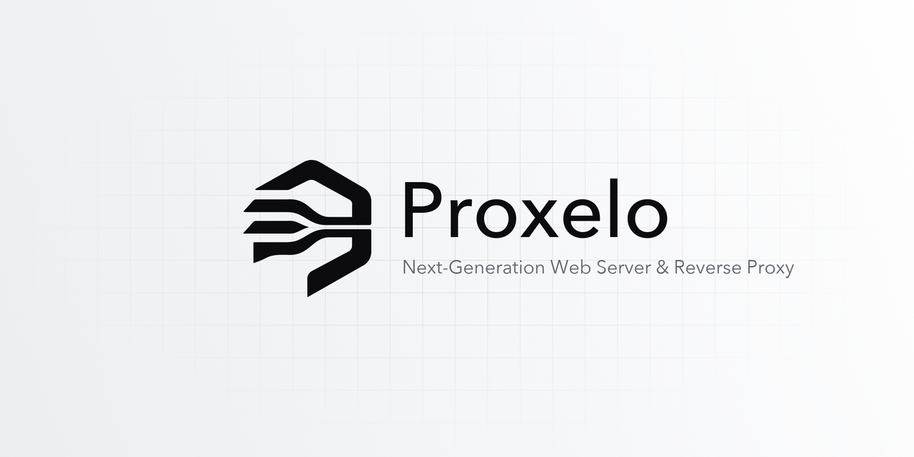

<picture>
  <source media="(prefers-color-scheme: dark)" srcset="docs/images/banner-dark.jpg">
  
</picture>

# Proxelo

Proxelo is a web server, reverse proxy and load balancer managed through an
API and a web UI.

It runs as two processes:

| Process | Repository | Role |
|---|---|---|
| `proxelo` | this repository (Go) | Control plane: API, web UI, storage, certificates, compiles configuration into snapshots |
| `proxelo-proxy` | [proxelo-proxy](https://github.com/null-variable/proxelo-proxy) (Rust) | Data plane: serves traffic from the active snapshot |

They share only the protocol in
[proxelo-api](https://github.com/null-variable/proxelo-api). A proxy keeps
serving its last good snapshot when the control plane is unavailable.

[docs/architecture.md](docs/architecture.md) explains the resource model,
how an edit reaches traffic, and the security boundaries.

## Status

Early development. The control plane stores Listener, Site, Route, Upstream,
Certificate and Policy resources in SQLite, serves them over a REST API, compiles them into snapshots
and pushes every applied snapshot to connected proxies. Routes cover the nginx
location kinds (exact, prefix, `^~`, `~`, `~*`) and nesting, rewrite, return,
error_page and try_files; error pages and try_files can hand off to another
route like an nginx named location. Routes can also match on methods, headers,
query arguments and a CEL expression; expressions are type-checked when saved.

Listeners can terminate TLS and offer HTTP/2; sites pick certificates by SNI
and can redirect plain requests to https. Certificates are uploaded as PEM
(the key is never returned by the API) or issued and renewed by the control
plane over ACME (HTTP-01 and TLS-ALPN-01, Let's Encrypt by default, 30 days
before expiry); an issued certificate goes out as the next revision on its own,
leaving open change sets unapplied. Upstreams balance by round robin,
least_conn, ip_hash, hash or hash_consistent (picking the same targets as
nginx), random or random_two. Targets can be backups, marked down, limited
with maxConns (with a request queue when all are full), ramped up with slow
start and re-resolved through DNS while running. Passive health and active
HTTP or TCP health checks take failing targets out; each proxy reports the
targets it has taken out to the control plane. Sticky sessions pin a client
by a cookie the proxy sets or by a route value from a variable. Proxy routes
set timeouts and retries.

Policies attach to sites and routes and are inherited down the route tree:
`headers` sets, adds or removes response headers and headers
sent upstream, merged by name with the closest policy winning; `accessLog`
picks the log for its routes (`combined`, `main`, `json` or a template). A
route with `"inheritPolicies": false` starts over.

Access policies run in nginx's order once the route is chosen:
`rateLimit` (a leaky bucket per key with burst, delay or noDelay, as
limit_req) and `connLimit` (requests in progress per key, as limit_conn),
each policy one zone shared by the routes it applies to; `ipAccess` allow
and deny rules, the first match deciding; `basicAuth` with inline users
hashed by htpasswd or openssl passwd; and `forwardAuth`, which asks an
upstream about each request as auth_request does and can copy its response
headers upstream. `bandwidth` throttles response bodies (limit_rate,
limit_rate_after), and `realIp`, on sites, takes the client address from a
header set by trusted proxies. Refusals go through the error pages.

### Changes

Every edit happens in a change set: `POST /api/v1/changesets`, then resource
writes with `?changeset=<id>`. Reads without `?changeset` show the current
revision; with it they show the change set's view. Several change sets can be
open; applying one merges it field by field onto edits applied since it
started, and a field changed on both sides is a conflict (`422`, with the
field path).

Validate runs field checks, reference resolution, compilation, a dry-load in
the proxy engine (`proxelo-proxy sim`, a resident helper, so Go and Rust never
disagree) and warnings: shadowed or unused routes, HTTPS without HSTS,
hostnames a certificate does not cover, a listener on the admin port. Diff
shows field-level resource changes and the effective change per compiled
listener, site, route and upstream, with inherited policies resolved.

Apply defaults to commit-confirm: the revision is `pending` and rolls back to
the last confirmed one unless `POST /revisions/{rev}/confirm` arrives within
`confirmTimeout` (120 s). While pending, proxies report traffic counters every
5 s and a guard compares the 5xx and upstream failure rates with the 5 minutes
before; a rise is recorded on the revision, and with `-guard-rollback` it rolls
back. `"mode": "direct"` skips the window, except for changes that touch the
admin port. Rollback to any revision is a new revision, so history is linear;
the newest 500 and every tagged revision are kept. `GET /api/v1/export` writes
a YAML bundle (keys left out) that `POST /changesets/{id}/import` loads back.

### Admin access

On first start, with no account, the control plane prints a one-time setup
token; `POST /api/v1/auth/setup` with it creates the owner. Passwords are
Argon2id; TOTP second factors are optional per account; five failed logins
lock an account for 15 minutes. Sessions are HttpOnly, SameSite=Strict
cookies with a CSRF token (`X-CSRF-Token` on every write), 30 min idle and 24 h
absolute expiry. API tokens (`Authorization: Bearer <token>`) carry a role up
to their creator's, an expiry and optional client networks, and are stored
hashed. Roles: owner, admin, operator (apply, confirm, rollback), editor
(change sets), viewer, and guest (signs in, reaches only its groups). The
admin API stays on loopback unless `-admin-allow` lists client networks.

Groups scope resources to teams and domains. A resource's `group` field puts
it in a group; groups nest, and each member holds a group role (viewer,
editor, operator or admin) that also applies in every subgroup. On a grouped
resource a principal acts with the higher of its instance role and its group
role; API tokens cap both. A group can list domains (`shop.example` covers
the name and everything under it): its sites may only serve hostnames inside
them, and a subgroup's domains stay inside its parent's. Members read the
ungrouped listeners and certificates their sites attach to, cannot reference
anything else outside their groups, apply only change sets whose resources
are all in groups where they are operators, and confirm only the revisions
they applied. Each revision records the groups whose resources it changed:
members list only those revisions, and change sets they opened or whose
resources they can all read. Instance-wide views (nodes, fleet traffic) need
an instance role. Group admins manage members up to their own role and create
subgroups; a group's domains are changed from its parent.

Every change, login, failure and recovery is written to an append-only audit
log whose entries are hash-chained (`GET /api/v1/audit`, `/audit/verify`).

Break-glass works only on the local socket `<data>/run/admin.sock` (0660):

```sh
proxelo admin reset-password --user owner   # new password, 2FA and sessions cleared
proxelo admin rollback --to last-confirmed
proxelo admin bind 127.0.0.1:9443          # move the admin API back
```

Run both processes together (development, home lab):

```sh
go build -o proxelo ./cmd/proxelo
./proxelo up -data ./data -listen 127.0.0.1:9443 -proxy ../proxelo-proxy/target/release/proxelo-proxy
```

Proxies expose Prometheus metrics on `127.0.0.1:9145/metrics` by default
(`-- --metrics <addr|off>`). ACME uses `-acme-directory` and `-acme-email`.

`up` starts `proxelo control` and `proxelo-proxy run` as children, restarts
either one if it exits and stops both on SIGTERM. Arguments after `--` go to
the proxy (`-- --workers 4 --runtime per-core`). In production run them as two
services instead:

```sh
proxelo control -data /var/lib/proxelo -listen 127.0.0.1:9443 -socket /run/proxelo/control.sock
proxelo-proxy run --data /var/lib/proxelo --socket /run/proxelo/control.sock
```

The proxy dials the control socket (gRPC `DistributionService.Sync` from
`proxelo-api`), receives the newest snapshot on connect and on every apply,
and answers each with an ack. It keeps the last snapshot it applied in
`<data>/proxy/lkg.snap` and starts from it, so it serves traffic while the
control plane is down and reconnects when it is back.

| Endpoint | Purpose |
|---|---|
| `GET /api/v1/{kind}[/{id}][?changeset=]` | List or read `listeners`, `sites`, `routes`, `upstreams`, `certificates`, `policies` |
| `POST/PUT/PATCH/DELETE /api/v1/{kind}[/{id}]?changeset=` | Create, replace, merge-patch (RFC 7396) or delete in a change set; `If-Match: "<resourceVersion>"` guards writes |
| `GET/POST /api/v1/changesets`, `GET/DELETE /changesets/{id}` | Change sets and what they touch |
| `GET /api/v1/changesets/{id}/diff` | Resource diff and effective diff |
| `POST /api/v1/changesets/{id}/validate` | Errors and warnings |
| `POST /api/v1/changesets/{id}/apply` | `{"mode": "confirm"\|"direct", "confirmTimeout": 120}` |
| `POST /api/v1/changesets/{id}/import`, `GET /api/v1/export` | YAML or JSON bundle |
| `GET /api/v1/revisions[/{rev}]` | Revision history (status, author, guard), or one revision with its resources |
| `POST /api/v1/revisions/{rev}/confirm`, `/rollback`, `PUT .../tag` | Commit-confirm, rollback (`0` empties), retention tag |
| `GET /api/v1/revisions/{rev}/snapshot` | Compiled snapshot (protobuf, includes keys; admin) |
| `GET /api/v1/nodes` | Connected proxies: active, last sent and last rejected revision |
| `GET /api/v1/traffic?window=5m` | Requests, 5xx, upstream attempts and failures summed over every proxy (window up to 15m) |
| `GET /api/v1/schema` | JSON Schema of every resource spec, generated from `internal/model` (`go generate ./internal/model`) |
| `POST /api/v1/simulate` | Run requests (`{"requests":[{"method","target","headers","remoteAddr","listener"}]}`) against the latest or a given `revision`, and with `"changeset"` against that change set as it would apply; returns site, route, rewritten URI, upstream or file, status and a trace |
| `/api/v1/auth/{status,setup,login,logout,me,password,totp/*,tokens}` | Accounts, 2FA, API tokens; `status` tells whether setup is pending, `me` returns the session CSRF token |
| `/api/v1/users`, `GET /api/v1/audit[/verify]` | Account management and audit log (admin) |
| `GET/POST /api/v1/groups`, `PATCH/DELETE /groups/{id}`, `PUT /groups/{id}/members`, `DELETE /groups/{id}/members/{user}` | Groups, their domains and member roles; the list returns the caller's effective role per group |
| `GET /api/v1/topology[?changeset=][&format=json\|mermaid\|dot][&traffic=5m]` | Request-flow graph (listener → site → route → upstream → target) of the resources the caller can read, as JSON or a Mermaid or Graphviz diagram; `traffic` (up to 15m) adds request and 5xx counts per node and edge |

Validation errors return `422` with field paths such as
`routes[rt_...].spec.action.proxy.upstream`.

A resource file can also be compiled offline:

```sh
go run ./cmd/proxelo compile examples/basic.json snapshot.bin
proxelo-proxy check snapshot.bin
```

### Web console

The admin listener serves the console at `/`. Its source is in `web/`
(Vite, React, TypeScript, TanStack Query and Router, SCSS; no Tailwind,
no CDN). The
build goes to `internal/ui/dist` and is embedded into the binary, so build
the web app before `go build`; without it the console answers 503.

```sh
cd web
bun install
bun run build                        # tsc --noEmit, then vite build into internal/ui/dist
PROXELO_API=127.0.0.1:9443 bun run dev   # dev server proxying /api to a running control plane
```

`go generate ./internal/ui` runs the same install and build.

| Screen | What it does |
|---|---|
| Dashboard | 5-minute traffic, 5xx and upstream failure rates, node sync, certificates expiring within 30 days, recent revisions, pending-confirmation banner |
| Sites, Routes, Upstreams, Certificates, Policies, Listeners | Lists with search; editors generated from `/api/v1/schema` (reference fields become pickers) with a Raw JSON tab; server field errors shown at the field; site route tree with nginx match badges |
| Topology | The configuration as a request-flow diagram, filterable by group; drag a node onto another (valid targets light up) or use the side panel to connect listener → site, site → route, route → child route or upstream, remove connections, attach or detach certificates and policies, add resources and upstream targets, all into the active change set; a traffic overlay sizes edges by recent requests and colors them by 5xx share; targets a proxy reports down are red; export as SVG, PNG, Mermaid, Graphviz DOT or JSON |
| Changes | Change sets (the active one is the draft every edit goes to), resource and effective diff, validate with safety findings, apply with commit-confirm, import, export, discard; revisions with confirm and rollback |
| Simulator | One request against the latest revision, side by side with the active change set |
| Nodes, Settings | Proxy sync state and the targets each proxy has taken out; password, TOTP, API tokens, groups with members and domains, users and the audit log |

Light and dark modes follow the system and can be switched. Pages are laid
out for 390px phones and up. The editors render from `GET /api/v1/schema`, so
a new model field shows up in the console after `go generate
./internal/model` with no web change.

### Database migrations

The store keeps its schema version in SQLite `PRAGMA user_version` and
upgrades on open (`internal/store/migrate.go`). Each migration is a
function appended to an ordered list and runs in its own transaction with
foreign keys checked afterwards. Before the first step the database is
copied to `proxelo.db.v<N>-<UTC time>.bak` with `VACUUM INTO`. A database
newer than the binary is refused. Databases from before change sets (no
version) migrate too: the latest revision becomes the head and unapplied
edits move into one change set.

To change the schema, append a migration; never edit a released one.
`TestNewAndMigratedSchemasMatch` checks that a new database and an
upgraded one end up identical.

## Layout

| Path | Contents |
|---|---|
| `cmd/proxelo` | Control plane binary |
| `internal/model` | Resources edited through the API, their field validation and generated JSON Schema |
| `internal/compile` | Resource to snapshot compiler, golden tests in `testdata/` |
| `internal/store` | SQLite storage: head resources, change sets, revisions, accounts, audit log |
| `internal/api` | REST API |
| `internal/deploy` | Apply, commit-confirm timer, guard, rollback |
| `internal/diff` | Field diff, three-way merge, effective snapshot diff |
| `internal/lint` | Validation warnings and admin-access safety checks |
| `internal/auth` | Argon2id, TOTP, instance and group roles |
| `internal/admin` | Admin listener with allowlist and rebinding |
| `internal/breakglass` | Local recovery socket |
| `internal/distrib` | Snapshot and ACME challenge distribution to proxies over the control socket |
| `internal/acme` | ACME issuance and renewal |
| `internal/topology` | Request-flow graph of a configuration, its traffic overlay and its Mermaid and DOT rendering |
| `internal/simulate` | Resident `proxelo-proxy sim` helper for dry-loads and simulation |
| `internal/ui` | Serves the embedded web console build |
| `web` | Web console source (Vite + React + TypeScript, bun) |
| `examples` | Sample resource files |
| `test/bench` | Benchmark harness: nginx vs `proxelo-proxy` (S1, S3), see its README |
| `test/conformance` | Differential test against nginx and the nginx directive coverage list, see its README |

## Development

```sh
go vet ./...
go test ./...
go test ./internal/compile -update   # rewrite golden snapshots
go generate ./internal/model         # rewrite schema.json after model changes
(cd web && bun install && bun run build)  # web console, before go build
PROXELO_PROXY=../proxelo-proxy/target/release/proxelo-proxy go test ./internal/compile -run TestRoundTrip
go run ./test/conformance -proxy ../proxelo-proxy/target/release/proxelo-proxy   # needs Docker
```

`TestRoundTrip` checks the snapshot contract with `proxelo-proxy`: every
compiled configuration loads in the proxy and routes to the site it was
compiled for. CI runs it against the proxy's main branch and its latest
release.

## License

Licensed under the [Apache License, Version 2.0](LICENSE). See [NOTICE](NOTICE).
