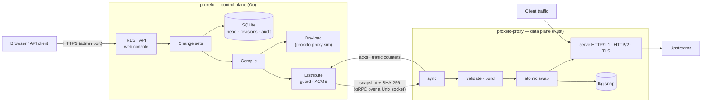
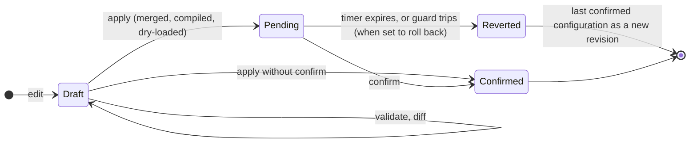
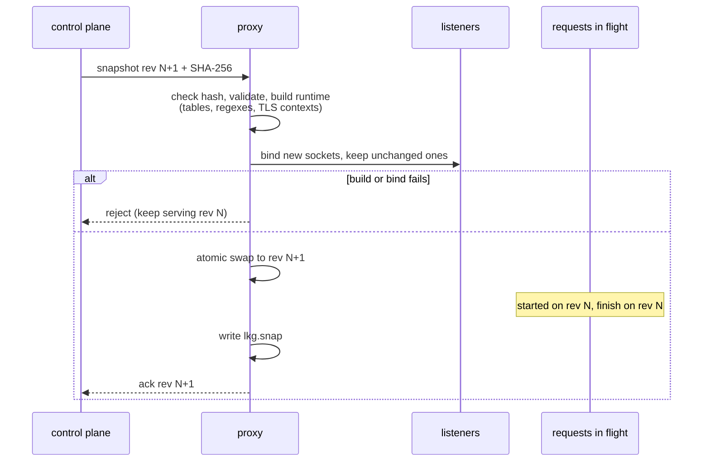
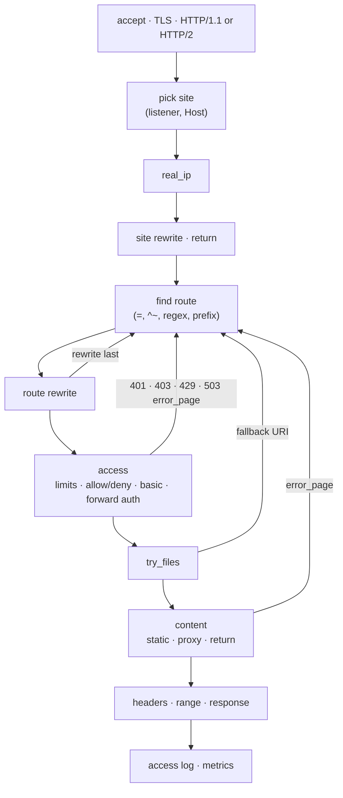

# Architecture

Proxelo is a web server and reverse proxy in the spirit of nginx, managed
through an API and a web console instead of configuration files. This page
explains how the pieces fit together. It is written for someone who has only
the three public repositories.

## Two processes

| Process | Repository | Language | Job |
|---|---|---|---|
| `proxelo` | [proxelo](https://github.com/null-variable/proxelo) | Go | Control plane: API, web console, storage, accounts, ACME, compiling configuration |
| `proxelo-proxy` | [proxelo-proxy](https://github.com/null-variable/proxelo-proxy) | Rust | Data plane: accepts connections and serves traffic |

The split follows one rule: everything that must be fast or must keep
running sits in the proxy; everything that is easier to change, validate or
present sits in the control plane. The proxy never reads user configuration,
never talks to a database and has no API of its own besides metrics.

The two processes share nothing but the messages in
[proxelo-api](https://github.com/null-variable/proxelo-api) (Protocol
Buffers). Neither imports the other's code, so each can be released on its
own as long as the protocol stays compatible.

## Resources

Users edit six kinds of resources. Each has an immutable ID with a kind
prefix (`site_…`, `rt_…`), a name, optional labels, description and group, an
`enabled` flag and a `spec`. Resources refer to each other by ID, so renaming
never breaks a reference.

| Kind | nginx counterpart | What it holds |
|---|---|---|
| Listener (`lst_`) | `listen` | Address, TLS settings, HTTP/2, default site |
| Site (`site_`) | `server` | Hostnames, listeners, routes, certificates, site-level rewrites, return and error pages, policies |
| Route (`rt_`) | `location` | Path match (`=`, prefix, `^~`, `~`, `~*`) and optional conditions (methods, headers, query, CEL), rewrites, an action (static, proxy, return), nested routes, error pages, policies |
| Upstream (`up_`) | `upstream` | Targets with weights and backups, balancing, passive health, keepalive |
| Certificate (`cert_`) | `ssl_certificate` | Uploaded PEM, or domains issued over ACME; status read from the chain |
| Policy (`pol_`) | `add_header`, `access_log`, … | Reusable settings attached to sites and routes, inherited down the route tree |

The JSON Schema of every spec is generated from the Go model
(`internal/model/schema.json`, served at `GET /api/v1/schema`). The web
console draws its forms from it, so a new field needs no console change.

## From an edit to traffic

1. **Change set.** Every edit goes into a change set, a draft on top of the
   current configuration (the *head*). Several can be open at once. Each item
   remembers the head version it started from.
2. **Validate.** Field checks, reference resolution, compilation to a
   snapshot, a dry-load of that snapshot in the real proxy engine
   (`proxelo-proxy sim`, kept running by the control plane) and warnings
   (shadowed routes, missing HSTS, a certificate that does not cover a
   hostname, a listener on the admin port).
3. **Diff.** Field-level changes per resource, and the *effective* change per
   compiled listener, site, route and upstream with inheritance resolved.
4. **Apply.** The change set is merged field by field onto the head. A field
   changed both in the change set and in the head since then is a conflict.
   The result is compiled into a snapshot and stored as a new *revision*.
5. **Distribute.** The snapshot bytes and their SHA-256 hash go to every
   connected proxy. A proxy checks the hash, validates the snapshot, builds
   its runtime form (lookup tables, compiled regexes, TLS contexts, bound
   sockets) and only then swaps it in atomically. Requests in flight finish
   on the snapshot they started with. The proxy acks the revision, or rejects
   it and keeps serving the previous one.
6. **Confirm.** Apply defaults to *commit-confirm*: the revision is pending
   and rolls back by itself unless confirmed in time (120 s by default).
   While it is pending, proxies report traffic counters every 5 s and a guard
   compares the 5xx and upstream failure rates with the five minutes before.

Rollback creates a new revision with an older configuration, so history
stays linear. The newest 500 revisions and every tagged one are kept.

### Inside the proxy

## Why snapshots

The control plane resolves everything a proxy would otherwise have to work
out per request: references, policy inheritance, defaults, the order nginx
uses to pick a site and a route. The snapshot is the finished answer. That
keeps the proxy small and fast, and it means the proxy can start from its
last good snapshot (`<data>/proxy/lkg.snap`) and keep serving while the
control plane is down.

The same compiled snapshot feeds the simulator, the dry-load in validation
and the proxies, so "what the console says" and "what the proxy does" come
from one engine.

## Control plane internals

| Package | Job |
|---|---|
| `internal/model` | Resource types, field validation, JSON Schema generator |
| `internal/compile` | Resources to snapshot; golden tests in `testdata/` |
| `internal/importer/nginx` | nginx configuration (`nginx -T` or archive) to resources, with a per-directive conversion report |
| `internal/store` | SQLite: head, change sets, revisions, accounts, sessions, tokens, audit log, versioned migrations |
| `internal/diff` | Field diff, three-way merge, effective snapshot diff |
| `internal/lint` | Warnings and admin-access safety checks |
| `internal/deploy` | Apply, commit-confirm timer, traffic guard, rollback |
| `internal/distrib` | gRPC stream to proxies: snapshots, ACME challenges, acks, traffic counters |
| `internal/topology` | Request-flow graph, traffic overlay, Mermaid and DOT rendering |
| `internal/simulate` | The resident `proxelo-proxy sim` helper |
| `internal/acme` | ACME issuance and renewal |
| `internal/api`, `internal/auth`, `internal/admin`, `internal/breakglass` | REST API, credentials and roles, admin listener, local recovery socket |
| `internal/ui`, `web/` | Web console (served from the binary) |

## Proxy internals

See the [proxelo-proxy README](https://github.com/null-variable/proxelo-proxy#readme)
for the crate layout. In short: `sync` receives snapshots, `snapshot`
validates them and builds the runtime form, `http1` is the codec, and
`server` runs the accept loops, TLS, HTTP/2, the request phases, static
files, proxying, logs and metrics.

The request phases follow nginx: real_ip, site rewrites and return, route
lookup, route rewrites, access (rate and connection limits, allow/deny,
basic auth, forward auth), `try_files`, content. Internal redirects, `rewrite last` and
named routes re-enter the phases the way nginx does. Once a keepalive
connection is warm, serving a request does not allocate; a test enforces it.

## Security boundaries

- The admin API listens on loopback unless `-admin-allow` lists client
  networks. Sessions are HttpOnly SameSite=Strict cookies with a CSRF token;
  API tokens are hashed and can be limited to networks.
- Roles are per instance and per group. A grouped resource answers to the
  higher of the two; groups nest and members inherit downward. Group members
  see only their groups' resources (plus shared listeners and certificates),
  cannot reference resources outside them, and their sites stay inside the
  group's domains. Applying needs operator on every group a change set
  touches.
- Private keys are stored by the control plane, sent to proxies inside
  snapshots, and never returned by the API.
- The control socket is a Unix socket created 0660 in a 0750 directory, so
  only root and the `proxelo` group reach it.
- The break-glass socket (`<data>/run/admin.sock`) offers password reset,
  rollback and rebinding of the admin API to someone with shell access on the
  control host, and writes every use to the audit log.
- The audit log is append-only and hash-chained; `GET /api/v1/audit/verify`
  detects tampering.
